<h1 align="center">Durgesh Sakhardande</h1>

Backend Engineer · Java · C#/.NET · Python · SQL

  
  
  
  

  
  

## About

I build backend services: REST APIs, the databases behind them, and the data pipelines that feed them.

- MS in Information Systems, Northeastern University
- AWS Certified Cloud Practitioner

## Tech

**Backend:** Java, Spring Boot, C#, .NET, Python, FastAPI
**Data:** PostgreSQL, MySQL, SQL Server, MongoDB, Redis
**Other:** Angular, TypeScript, Docker, Git

## Projects

| Project | What it does |
|---|---|
| [AdventureWorks Pipeline](https://github.com/DurgeshS-25/Adventure-works-Piepline) | End-to-end data pipeline on the Adventure Works dataset |
| [Reddit Pipeline](https://github.com/DurgeshS-25/Reddit-Pipeline) | Ingests and processes Reddit data |
| [Urban Traffic Collision Pipeline](https://github.com/DurgeshS-25/Urban-Traffic-Collision-Pipeline) | Analyzes urban traffic collision data |
| [Intelligent Research Assistant](https://github.com/shalakapadalkar16/Intelligent-Research-Assistant) | AI-powered research assistant (team project) |

## Activity

  

  

